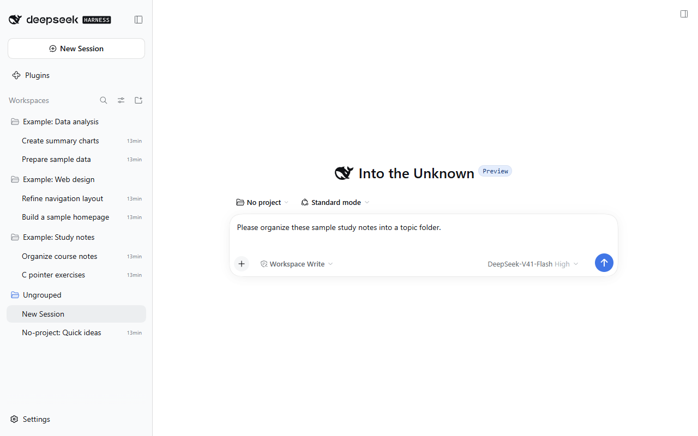
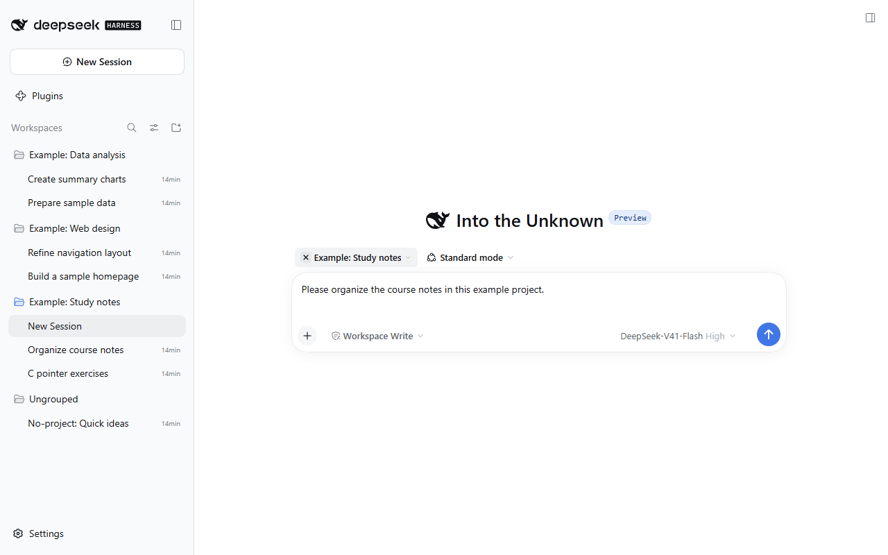
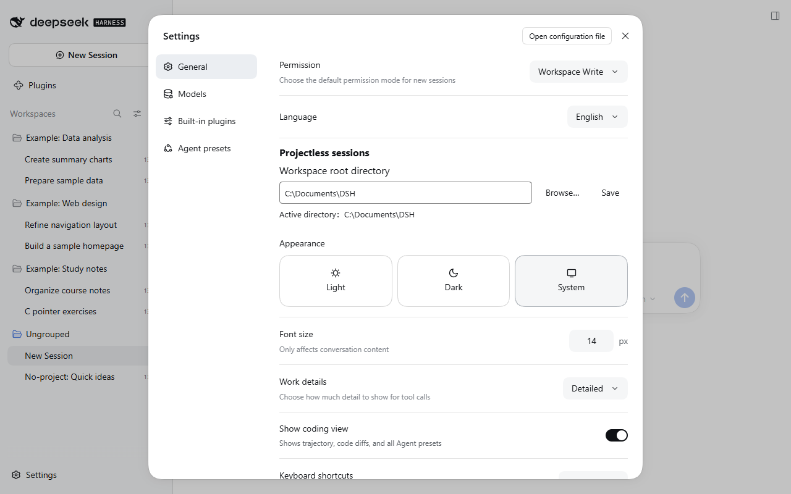

# DSH Codexlike Projectless

**English** | [简体中文](README.zh-CN.md)

Write first, choose a project later. This plugin adds Codex-like no-project conversations to DeepSeek Harness: compose a local draft, then create a working directory organized by date and topic on the first send.

[Download v1.4.0](https://github.com/NoProblUm/dsh-codexlike-projectless/releases/tag/v1.4.0) · [npm](https://www.npmjs.com/package/dsh-codexlike-projectless/v/1.4.0) · [Changelog](CHANGELOG.md) · [Validation report](docs/1.4.0-验收报告.md)

## Compatibility

**1.4.0 targets Windows x64 DSH Desktop 0.2.2-rc.3**, exact clean build `6b729fedde0c8fd03af7afdf5a711aa64fe87c3b`. The adapter checks the host build and module fingerprints at runtime.

| DSH Desktop | Plugin version | Notes |
| --- | --- | --- |
| 0.2.2-rc.3 | [1.4.0](https://github.com/NoProblUm/dsh-codexlike-projectless/releases/tag/v1.4.0) | Exact Windows x64 build above |
| 0.2.1-rc.5 | [1.3.0](https://github.com/NoProblUm/dsh-codexlike-projectless/releases/tag/v1.3.0) | Use that release's verified build |
| 0.2.1-rc.3 | [1.2.0](https://github.com/NoProblUm/dsh-codexlike-projectless/releases/tag/v1.2.0) | Use that release's verified build |
| 0.2.1-rc.2 | [1.1.0](https://github.com/NoProblUm/dsh-codexlike-projectless/releases/tag/v1.1.0) | Use that release's verified build |
| Other builds or platforms | Not validated | Do not bypass the compatibility check |

The 1.x adapter is included in the plugin package. There is no separate installer, Node.js requirement for users, or app.asar modification. If you installed a patched 0.x version, restore the original application using its installation record before migrating.

## Install or update

1. Download [dsh-codexlike-projectless-1.4.0.tgz](https://github.com/NoProblUm/dsh-codexlike-projectless/releases/download/v1.4.0/dsh-codexlike-projectless-1.4.0.tgz) and [SHA256SUMS](https://github.com/NoProblUm/dsh-codexlike-projectless/releases/download/v1.4.0/SHA256SUMS).
2. Verify the archive's SHA-256, then import the local package through DSH's official plugin manager.
3. Quit and reopen the entire DSH application normally. A hot enable may show a restart-required status.
4. Under **Settings → General → No-project conversations**, choose a workspace root and save it. Check that the runtime status is ready.

To check the download in PowerShell:

```powershell
Get-FileHash .\dsh-codexlike-projectless-1.4.0.tgz -Algorithm SHA256
```

Match the hash with `SHA256SUMS`. For an upgrade from Desktop 0.2.1-rc.5 with plugin 1.3.0, use a backup copy of the profile to check that history and the saved root are preserved. Save unsent drafts before restarting.

Disable or uninstall through the official manager. This releases the plugin's runtime wrappers while preserving created conversations, directories and user files. Save unsent draft content before disabling or removing it. An old `link:` installation should be removed through the manager before importing the package.

## Using no-project conversations

- Hover or keyboard-focus the project button and activate its close icon, or choose **No project** in the project picker.
- Write text, add files or images, and choose a model, Agent preset, permissions or planning mode using the native controls.
- In no-project mode, New Conversation, its shortcut and the Ungrouped sidebar action restore the most recently used eligible unsent draft. A local draft is created when none qualifies. In a project, normal new-conversation behavior delegates blank reuse to DSH.
- Initialization requests follow the native keep, replace or append policy. Requests carrying an Agent preset do not reuse a draft that explicitly lists a different preset. Initialization does not send the message.

Before first send, the draft creates no host Session, Workspace or task directory. On the first send:

1. DSH's built-in title service generates a topic using the selected model, with the native fallback if title generation fails.
2. The plugin creates `ROOT/YYYY-MM-DD/topic`, adding `_2`, `_3`, etc. for collisions, and creates one real Session.
3. The native send path receives the text, attachments and selected controls.
4. After acceptance, the temporary Workspace registration is removed. The Session, directory, cwd and history remain; the conversation appears under Ungrouped.

The native composer, project control and Agent mode row stay in place. Sent conversations keep their native layout without an extra project bar. If acceptance cannot be confirmed, the plugin blocks resending and preserves uncertain resources while awaiting native persistent Session state. A cleanup failure locks the draft; cleanup retries do not send the message again.

## Workspace root

Save a root under **Settings → General → No-project conversations**. The UI displays the effective path; failed validation or saving leaves the old value in place. The override is stored in `DSH_HOME/storages/dsh-codexlike-projectless-settings.json` and survives restarts.

Without an override, the root comes from the profile's `dsh-codexlike-projectless.config.root`, falling back to `~/Documents/DSH`. A change affects future first sends; existing directories are not moved. Each in-progress first send retains its starting root for allocation and rollback.

## Screenshots

These unmodified screenshots were captured on 2026-10-03 from a real, running DSH Desktop 0.2.0-rc.2 instance on Windows with the pre-rename development build 0.7.0-local.5. The isolated profile loads only DSH's built-in components and this plugin, using the native UI without theme, pet or enhanced sidebar plugins. Three example projects, six project conversations and one ungrouped conversation were created specifically for this demonstration; no personal conversation history is included. The example conversations illustrate project membership, not model execution results. Interface labels, example project names, conversation titles and draft text are shown in English.

### No-project draft alongside project conversations

The sidebar shows three example projects and their conversations, while the current editor is in no-project mode with native model, permissions and Agent preset controls. An example under Ungrouped illustrates the difference from project-bound conversations.



### Switch from a project to no-project mode

This historical screenshot shows the older circular ×; 1.1.0 uses the host's native close icon to open the no-project editor. The selected project is "Example: Study notes", with other projects and ungrouped conversations visible in the sidebar.



### Choose the conversation directory

General Settings lets you browse, save and inspect the effective workspace root. The example root is `C:\Documents\DSH`; you can choose your own location.



## Validation and limits

Version 1.4.0 adapts the workspace picker, composer, first-send confirmation and attachment uploads for DSH 0.2.2-rc.3. The Ungrouped sidebar action appears on row hover or keyboard focus. The build, type checking and **91 automated tests** passed. See the report for the scope of the isolated Desktop tests. [Validation report](docs/1.4.0-验收报告.md)

- Draft text, references, attachments and editor controls live in client memory and do not survive refresh, closing or restart. The selected project and saved root persist.
- Git Graph 0.4.6, other third-party combinations and host-installer overwrite upgrades are outside this candidate's validation scope.
- Tools, tasks and commands requiring a real Session or execution directory become available after the first message creates the Session.

## Development

From the release checkout, run these commands with Node.js 22.19 or newer.

```powershell
npm ci
npm run verify
npm pack --ignore-scripts
```

See [CONTRIBUTING.md](CONTRIBUTING.md) for development and historical validation. The release workflow verifies Windows and Linux builds, creates a GitHub Release with the plugin archive and SHA256SUMS, then publishes the same archive to npm through the configured trusted publisher. Stable versions use npm's `latest` tag. Test profiles, host application archives and raw runtime logs are excluded from the public repository and package.

## Attribution and license

This independently maintained project is based on [Jarvis Luk's dsh-projectless-session](https://github.com/jarvisluk/dsh-projectless-session). Thanks to [Jarvis Luk](https://github.com/jarvisluk) for the original projectless conversation work and MIT-licensed source foundation.

The original copyright and MIT license are retained in [LICENSE](LICENSE), with source attribution in [NOTICE](NOTICE). The pinned Git Graph compatibility route includes Apache-2.0 code; its attribution, modifications and license are in [THIRD_PARTY_NOTICES.md](THIRD_PARTY_NOTICES.md).

Maintained independently by NoProblUm. This is not an official DeepSeek or OpenAI project. The repository and package name are both `dsh-codexlike-projectless`.
