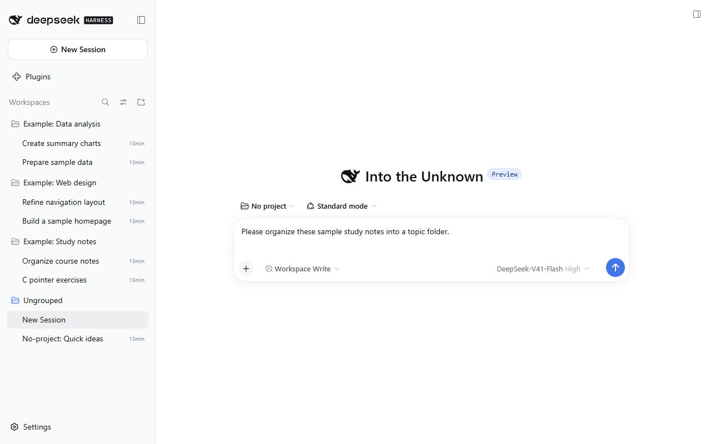
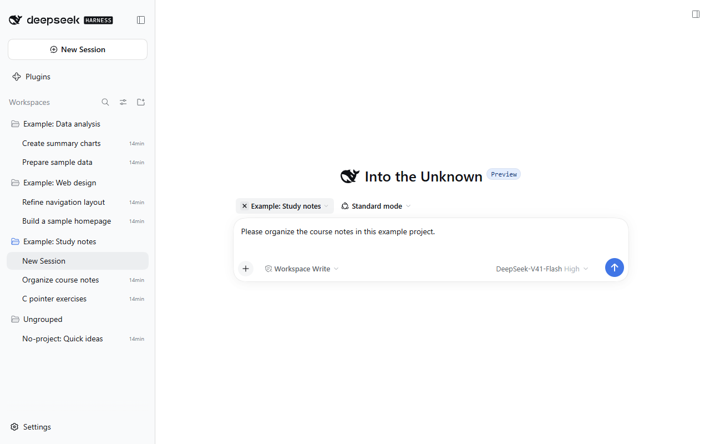
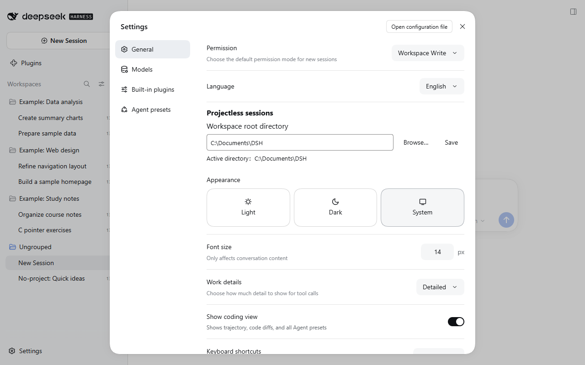

# dsh-codexlike-projectless

**English** | [简体中文](README.zh-CN.md)

Codex-like no-project conversations for DeepSeek Harness: write your message first, then create a working directory organized by date and topic when you send it.

DSH Codexlike Projectless is independently maintained with its own release history. The repository and internal plugin are both named `dsh-codexlike-projectless`. Source attribution and MIT license details are in [NOTICE](NOTICE) and [LICENSE](LICENSE). This is not an official DeepSeek or OpenAI project.

## Current version and 0.x

The current version is **1.0.1**, for Windows DSH Desktop **0.2.1-rc.2** (build `332895e0f7c9d4dbfb29729f5eb367fa263ff986`). Install the [1.0.1 plugin package](https://github.com/NoProblUm/dsh-codexlike-projectless/releases/download/v1.0.1/dsh-codexlike-projectless-1.0.1.tgz) through the plugin market or official plugin manager, then quit and reopen DSH.

0.x required a separate native patch. 1.x includes the runtime adapter in the plugin package and needs no external installer or archive changes. If you installed an old patch, restore the original application using its installation record before installing this version. No-project drafts and dated topic directories on first send work as before.

The original screenshots remain below. See [CHANGELOG](CHANGELOG.md) for release details.

Independent release numbering starts at `0.1.0`. Release packages do not include DSH's `app.asar`, user profiles or local backups.

## How it works

1. A new no-project conversation opens a browser-only draft with the native composer. No real Session, Workspace or working directory is created yet.
2. On the first send, DSH's built-in title service generates a topic using the current model. If it fails, the native fallback title is used.
3. The plugin creates `ROOT/YYYY-MM-DD/topic`, appending `_2`, `_3`, etc. for collisions. It then creates a real Session and binds the prepared title to its native event log.
4. The message goes through the native send path with its selected model, Agent preset, permissions, planning mode and attachments.
5. After acceptance, the temporary Workspace registration is removed. The conversation, directory, cwd and history remain, and the conversation appears under Ungrouped.

A circular × appears to the left of the project button above the composer on hover or keyboard focus. In an unsent editor, it switches to no-project mode and restores that draft. In a project conversation that has already sent a message, it opens a new blank no-project editor while preserving the original conversation's project and cwd. The × is hidden in no-project mode; the picker also provides a "No project" entry.

New Conversation and the shortcut open a blank editor using the current default project selection. Opening history updates that selection. A no-project conversation retains its no-project identity after its temporary Workspace is detached. The selection survives restarts; a deleted project falls back to no-project mode.

Switching through the project picker restores the most recently used unsent editor for each project and for no-project mode, including text, attachments, model, permissions, Agent preset and planning mode. Selecting the current project again does not recreate the editor. Explicitly starting a new conversation opens a blank editor without carrying over text or attachments, while previous editors remain available during that runtime. Confirmed sends clear the corresponding recoverable draft; failures retain it, and uncertain results block resending.

An uncertain send is not retried and does not delete resources. The plugin waits for confirmation from native persistent Session state. Explicit rejection or creation failure reclaims only newly allocated empty directories; existing files are not deleted.

## Screenshots

These unmodified screenshots were captured on 2026-10-03 from a real, running DSH Desktop 0.2.0-rc.2 instance on Windows with the pre-rename development build 0.7.0-local.5. The isolated profile loads only DSH's built-in components and this plugin, using the native UI without theme, pet or enhanced sidebar plugins. Three example projects, six project conversations and one ungrouped conversation were created specifically for this demonstration; no personal conversation history is included. The example conversations illustrate project membership, not model execution results. Interface labels, example project names, conversation titles and draft text are shown in English.

### No-project draft alongside project conversations

The sidebar shows three example projects and their conversations, while the current editor is in no-project mode with native model, permissions and Agent preset controls. An example under Ungrouped illustrates the difference from project-bound conversations.



### Switch from a project to no-project mode

Hovering over the project button reveals a circular × that opens the no-project editor. The selected project is "Example: Study notes", with other projects and ungrouped conversations visible in the sidebar.



### Choose the conversation directory

General Settings lets you browse, save and inspect the effective workspace root. The example root is `C:\Documents\DSH`; you can choose your own location.



## Installation and removal

You need Windows and the supported DSH Desktop 0.2.1-rc.2 build. 1.0.1 includes the runtime adapter. Installing the plugin requires no Node.js, external installer or native patch.

### 1. Install from the plugin market

1. Search for `dsh-codexlike-projectless` in DSH's plugin market and install version 1.0.1.
2. Quit and reopen the entire DSH application normally.
3. Choose and save a workspace root under Settings → General → No-project conversations.

### 2. Import the release package

1. Download [dsh-codexlike-projectless-1.0.1.tgz](https://github.com/NoProblUm/dsh-codexlike-projectless/releases/download/v1.0.1/dsh-codexlike-projectless-1.0.1.tgz).
2. Import it through the plugin market or official plugin manager, then quit and reopen DSH normally.
3. Set a workspace root under Settings → General → No-project conversations.

### 3. Build from source

Development requires Git and Node.js 22.19 or newer:

```powershell
git clone https://github.com/NoProblUm/dsh-codexlike-projectless.git
cd dsh-codexlike-projectless
npm ci
npm run verify
npm pack --ignore-scripts
```

Import the resulting `.tgz` as described above. See [CONTRIBUTING.md](CONTRIBUTING.md) for development and validation details.

### Migrate a patched 0.x installation

Disable the old plugin and restore the original application using its installation record before installing 1.0.1. If the old installer left a local `link:` copy, remove it through the manager first. Old recovery tools may restore other plugin settings from their backup; check the backup and any later changes before using them.

### Update and remove

Use the plugin market or official plugin manager, and quit and reopen DSH after updating. The stock manager may reject an in-place update under HMR with `already-installed`. This known limitation is documented in the [adaptation record](docs/适配-DSH-0.2.1-rc.2.md).

Disabling or removing the plugin releases its runtime changes and preserves created conversations, directories and user output. Save any unsent drafts first.

### Choose a workspace root

In Settings → General, find the no-project conversation section. Enter a workspace root or click Browse, then Save. The UI shows the effective path; validation or save failures leave the old value in place. The setting is stored in `DSH_HOME/storages/dsh-codexlike-projectless-settings.json`, survives restarts and does not rewrite unrelated profile settings.

Without a saved override, the root comes from the profile's `dsh-codexlike-projectless.config.root`, falling back to `~/Documents/DSH`. Changes affect only future first sends; existing conversations and directories are not moved. Each first send keeps the root selected when it began, including for rollback. Setting `debug: true` enables diagnostic logging of state and paths, without message text or secrets.

## Validation and limitations

The `0.1.1` installer integration tests cover first installation, updates, configuration preservation and rollback using synthetic ASAR archives with actual DSH 0.2.0-rc.2 module code. They do not establish live Desktop installation or restart acceptance. Earlier build checks: [0.1.0 validation](docs/独立初版验证.md).

See the [historical local validation record](docs/本地完整版测试.md) (Chinese). Its versions, logs and screenshots refer to development builds before the rename; they do not establish installation and restart acceptance for `0.1.0`. Drafts support model, preset, permissions and planning mode selection, plus attachments. Tools, tasks and commands that require a real Session or execution directory become available after the first message creates the Session. Draft text and attachments exist only in runtime memory and do not survive refresh, closing or restart. Quit and reopen DSH normally after installing or updating the plugin.

## Acknowledgements

Special thanks to [Jarvis Luk](https://github.com/jarvisluk) and the original [jarvisluk/dsh-projectless-session](https://github.com/jarvisluk/dsh-projectless-session) repository, the main reference and source foundation for this project. This project includes code derived from that MIT-licensed repository and builds on its projectless conversation work with the Codex-like workflow described above.

The original copyright and MIT license are retained in [LICENSE](LICENSE), with source attribution in [NOTICE](NOTICE). This repository is maintained independently by NoProblUm.

## Releases and development

Source and version downloads are available in [GitHub Releases](https://github.com/NoProblUm/dsh-codexlike-projectless/releases). The release workflow publishes to GitHub only. Each Release includes a `.tgz` plugin package and `SHA256SUMS`. It does not publish to npm. See CONTRIBUTING.md to build from source.

See [CONTRIBUTING.md](CONTRIBUTING.md) for development and validation, and [CHANGELOG.md](CHANGELOG.md) for version history. Paths to logs, screenshots and backups in historical validation records describe the evidence from those runs. Apart from the selected screenshots above, those runtime artifacts are excluded from the public repository. Further checks and optimization are tracked through this repository's Issues and future releases.
