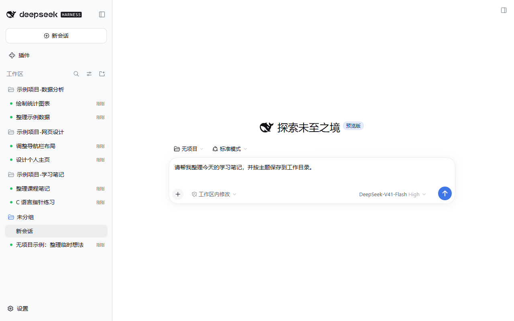
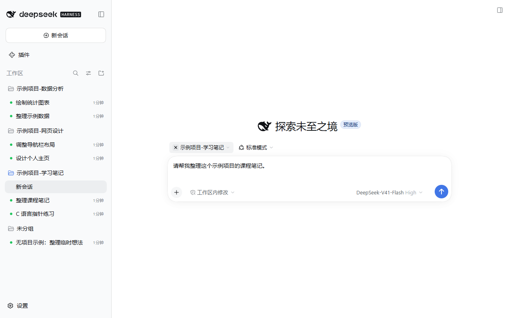
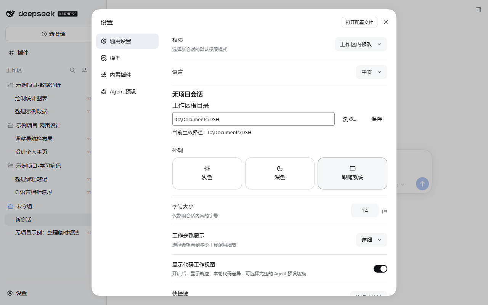

# DSH Codexlike Projectless

[English](README.md) | **简体中文**

先写消息，首次发送时再创建项目目录。这个插件为 DeepSeek Harness 提供类似 Codex 的无项目会话体验，把会话目录按日期和主题组织起来。

[下载 v1.3.0](https://github.com/NoProblUm/dsh-codexlike-projectless/releases/tag/v1.3.0) · [npm](https://www.npmjs.com/package/dsh-codexlike-projectless) · [变更日志](CHANGELOG.md) · [验收报告](docs/1.3.0-验收报告.md)

## 兼容版本

**1.3.0 支持 Windows x64 DSH Desktop 0.2.1-rc.5**，仅限原版、dirty=false 的精确构建 `d4db512a969fccf0c5cc7ec8fe38e9c1d27af916`。适配层会核对实际构建号和原版模块指纹。

| DSH Desktop | 插件版本 | 说明 |
| --- | --- | --- |
| 0.2.1-rc.5 | [1.3.0](https://github.com/NoProblUm/dsh-codexlike-projectless/releases/tag/v1.3.0) | 仅限上述 Windows x64 精确构建 |
| 0.2.1-rc.3 | [1.2.0](https://github.com/NoProblUm/dsh-codexlike-projectless/releases/tag/v1.2.0) | 使用对应发行说明中的已验证构建 |
| 0.2.1-rc.2 | [1.1.0](https://github.com/NoProblUm/dsh-codexlike-projectless/releases/tag/v1.1.0) | 使用对应发行说明中的已验证构建 |
| rc.4、其他构建或平台 | 未验证 | 不应绕过兼容性检查 |

1.x 已把运行时适配层放进插件包，使用时无需单独安装器、Node.js 或改写 app.asar。曾安装 0.x 归档补丁的用户，需先按原安装记录恢复原版应用，再迁移插件。

## 安装与更新

1. 下载 [dsh-codexlike-projectless-1.3.0.tgz](https://github.com/NoProblUm/dsh-codexlike-projectless/releases/download/v1.3.0/dsh-codexlike-projectless-1.3.0.tgz) 和 [SHA256SUMS](https://github.com/NoProblUm/dsh-codexlike-projectless/releases/download/v1.3.0/SHA256SUMS)。
2. 核对包的 SHA-256，再通过 DSH 插件市场或官方插件管理器导入。如果市场已显示与宿主匹配的版本，也可以直接安装或更新；市场仍显示旧版本时，使用包导入方式。
3. 正常退出并重新打开整个 DSH。热启用可能显示“请正常重启应用”。
4. 在 **设置 → 通用 → 无项目会话** 中选择工作区根目录并保存，确认运行时状态已就绪。

PowerShell 校验命令：

```powershell
Get-FileHash .\dsh-codexlike-projectless-1.3.0.tgz -Algorithm SHA256
```

将结果与 SHA256SUMS 比较。从 rc.3 升级宿主前先备份数据，再由官方管理器更新到匹配的插件并正常重启。未发送草稿不会跨这次重启保存。

停用或卸载通过官方管理器操作，会释放插件的运行时包装，保留已经创建的会话、目录和用户文件。操作前请自行保存未发送正文。旧安装器留下的 `link:` 副本应先通过管理器移除，再导入发布包。

## 使用无项目会话

- 悬停项目按钮或用键盘聚焦，点击原位显示的关闭图标；也可以在项目菜单中选择 **无项目**。
- 使用原生输入框写正文、添加文件或图片，并选择模型、Agent 预设、权限和规划模式。
- 在无项目状态，普通新建、快捷键及侧栏“未分组”入口优先恢复最近符合条件的未发送草稿；没有候选时才创建本地草稿。项目内普通新建委托 DSH 的原生空白会话复用逻辑。
- 带初始化参数的请求按宿主的保留、替换或追加策略处理；指定 Agent 预设时，不复用明确列出其他预设的草稿。初始化不会自动发送消息。

首次发送前，草稿不会创建真实 Host Session、Workspace 或任务目录。发送时：

1. DSH 原生标题服务使用所选模型生成主题；失败时使用原生回退标题。
2. 插件创建 `根目录/YYYY-MM-DD/主题`，重名时追加 `_2`、`_3`，再创建一个真实 Session。
3. 正文、附件和所选控制项经原生发送链路提交。
4. 确认接收后注销临时 Workspace，保留 Session、目录、cwd 和历史，会话进入“未分组”。

原生输入框、项目按钮和 Agent 模式栏保持原位；已发送页保留原生布局，不额外插入项目栏。发送结果无法确认时，插件禁止重发并保留不确定资源，等待原生持久会话状态对账。清理失败会锁定草稿，清理重试不会再次发送消息。

## 工作区根目录

在 **设置 → 通用 → 无项目会话** 中填写或浏览选择根目录，再点击保存。界面显示当前生效路径，验证或保存失败时保留原值。覆盖值保存在 `DSH_HOME/storages/dsh-codexlike-projectless-settings.json`，重启后继续生效。

未保存覆盖值时，使用 profile 中的 `dsh-codexlike-projectless.config.root`；未配置则回退到 `~/Documents/DSH`。修改只影响后续首次发送，不迁移已有目录。已经开始的首发固定使用开始时的根目录，包括分配和回收。

## 运行截图

以下图片于 2026-10-03 在 Windows 上实际运行的 DSH Desktop 0.2.0-rc.2 隔离环境中拍摄，插件版本为改名前开发构建 0.7.0-local.5。仅加载 DSH 内置组件和本插件，使用原生界面，没有主题、宠物或增强侧栏插件。三个示例项目、六条项目内会话和一条未分组会话均为专门创建的演示数据，不含个人会话历史；它们用于展示项目归属，不代表模型执行结果。原图未修改。

### 无项目草稿与项目会话对比

侧边栏展示三个示例项目及其会话；当前编辑页为“无项目”，可以直接输入正文并选择原生模型、权限和 Agent 预设。“未分组”中的示例会话与项目内会话形成对比。



### 从项目切换到无项目

此历史截图展示旧版圆形 ×；1.1.0 使用宿主原生关闭图标，点击后进入无项目编辑页。图中选择了“示例项目-学习笔记”，左侧保留其他项目及未分组会话。



### 设置会话目录

在通用设置中配置“工作区根目录”，浏览、保存并查看当前生效路径。图中演示根目录为 `C:\Documents\DSH`，可按需要选择自己的目录。



## 验证与限制

1.3.0 已通过类型检查、**88 项测试**和构建。隔离测试使用官方原版 rc.5 提取副本、独立 profile、官方管理器和无密钥模型 fixture，覆盖首发、附件、标题回退、提交故障与对账、清理、安装/更新/停用/卸载/重装、rc.3 + 正式 1.2.0 升级，以及 **12 组草稿布局、48 组原生 UI 对照、10 组思考显示对照**。正式包还完成安装、正常重启、ready、唯一首发和实际安装字节核对。具体范围见 [验收报告](docs/1.3.0-验收报告.md)。

- 草稿正文、引用、附件和控制项仅在客户端内存中保留，不跨刷新、关闭或重启保存。项目选择和保存的根目录可以持久化。
- 继续排除 Git Graph 0.4.6 组合。此前在 rc.3 单独测试时丢失过初始化正文，本版没有承诺 rc.5 组合支持；未知导航包装仍会被拒绝。
- 800 宽、150% 缩放下，宿主 hero 内容仍可能裁剪，插件开关一致。UI 对照限于记录的几何和交互，不表示所有界面均无遮挡。
- fixture 不证明外部模型的认证、联网、计费或服务质量；未测试 Windows 宿主安装程序覆盖升级、翻译渲染器专项或任意第三方组合。
- 需要真实 Session 或执行目录的工具、任务和命令，在首次消息创建真实会话之后使用。

## 开发

需要 Git 和 Node.js 22.19 或更新版本：

```powershell
git clone https://github.com/NoProblUm/dsh-codexlike-projectless.git
cd dsh-codexlike-projectless
git checkout v1.3.0
npm ci
npm run verify
npm pack --ignore-scripts
```

开发和历史验证说明见 [CONTRIBUTING.md](CONTRIBUTING.md)。发行工作流先运行 Windows/Linux 检查，再创建包含插件包和 SHA256SUMS 的 GitHub Release，随后通过配置的可信发布机制把同一包发布到 npm；正式版使用 npm 的 `latest` 标签。测试 profile、宿主归档和原始运行日志不进入公开仓库或发行包。

## 来源与许可

本项目独立维护，源自 [Jarvis Luk 的 dsh-projectless-session](https://github.com/jarvisluk/dsh-projectless-session)。感谢 [Jarvis Luk](https://github.com/jarvisluk) 提供最初的无项目会话实现和 MIT 许可源码基础。

[LICENSE](LICENSE) 保留原版权和 MIT 许可，[NOTICE](NOTICE) 记录源码来源。固定版本的 Git Graph 适配路由包含 Apache-2.0 代码，来源、修改和许可见 [THIRD_PARTY_NOTICES.md](THIRD_PARTY_NOTICES.md)；保留这段代码不代表 rc.5 上支持该插件组合。

由 NoProblUm 独立维护，非 DeepSeek 或 OpenAI 官方项目。仓库名和 npm 包名均为 `dsh-codexlike-projectless`。
